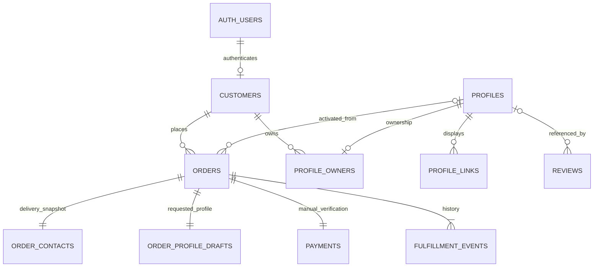

> **Historical snapshot archived 15 October 2026.** Source: `EdgetapFlow/docs/SUPABASE_MIGRATION_AUDIT.md` before this launch audit. Superseded status/commands below are evidence of their original run, not current instructions or authorization. Read [current launch status](../LAUNCH_STATUS.md). Unique original content is retained; relative links were rebased for this archive.

> **Hosted setup follow-up:** the confirmed project `dxyxvervvlxhwwbcbttd` is initialized clean. Schema/RLS/buckets/Auth settings and anonymous/API boundaries are hosted-verified; real accounts/emails/order/payment success flows are still pending. See [SUPABASE_MIGRATION_REPORT.md](SUPABASE_MIGRATION_REPORT.md).

> **Current decision (7 October 2026):** the owner explicitly waived source preservation: Firebase records/user/images are disposable TEST DATA. Start clean in Supabase; do not recover, migrate or delete them. This is the historical read-only inventory, not the current setup requirement. See [SUPABASE_MIGRATION_REPORT.md](SUPABASE_MIGRATION_REPORT.md) for current clean-start status and hosted verification blockers.

# EdgeTap Firebase → Supabase audit and proposal

7 October 2026 · branch `launch-readiness` · source commit `9e66b94`

**Historical pre-implementation audit.** The owner subsequently approved local implementation with “do it”. The architecture/inventory below records the original audit at `9e66b94`; see [SUPABASE_MIGRATION_REPORT.md](SUPABASE_MIGRATION_REPORT.md) for current implemented code and remaining source/destination blockers. Firebase data/rules/billing/Hosting and production services remain unchanged; no hosted Supabase objects or customer records have been created. Existing user edits and screenshot deletions are preserved.

## 1. Current Firebase architecture

Next.js 16.3.8 / React 19 static export (`output: "export"`, `out/`), served by Firebase Hosting project `edgetapflow` at the confirmed canonical `https://edgetapflow.web.app`. Browser Firebase SDK 12.19.0 provides Auth, Firestore and Storage. There is no application API/server, payment gateway, notification worker, courier integration or Cloud Functions dependency.

The audit inspected all current app/component/lib/script source paths (18 app, 28 component, 13 library and 7 script files), their Firebase imports/call sites, domain types, rules, indexes, configuration and operational documentation. Generated bundles, historical logs/screenshots and unrelated local worktrees are not the active application architecture or a verified data backup.

### Auth and authorization

- Checkout uses `createUserWithEmailAndPassword` and `signInWithEmailAndPassword`, with existing-email sign-in fallback and account-email match.
- `/account`: email/password login, logout and `onAuthStateChanged`; safe local profile return paths. Customer password recovery UI is not implemented.
- `/admin`: login/logout, password reset email, auth listener, then reads `config/admin_uids` and verifies current UID membership. A signed-in account alone is not staff.
- Profile editor subscribes to Auth and compares `user.uid` with `profile.ownerUid`; UI gating is backed by Firestore rules. Logout removes owner access.
- Admin component props use Firebase `User`; no OAuth, phone, anonymous signup, MFA or custom-claims authorization is implemented in current application source.
- Firestore rules resolve staff membership through the database's `config/admin_uids`; Storage's staff lookup specifically uses `(default)`, independent of configurable client database selection.

### Queries, listeners, transactions and relationships

| Operation | Current implementation |
|---|---|
| Public profile | `getDoc(profiles/{username})`; inactive rejected. Founder static seed only after a successful missing-document read, not after an exception. Route has a 15-second UI wait bound |
| Owner edit | `updateDoc` for displayName/title/bio/location/links, with `serverTimestamp()` updatedAt |
| Staff founder editor | Direct `getDoc` and merge `setDoc` for `profiles/ibraheem`; attaches staff UID if ownership absent |
| Create order | Authenticated `addDoc(orders)`, random Firestore ID, standard plan/JazzCash pending, quantity × Rs. 999, null deliveryFee/total |
| Staff orders | `getDocs` ordered createdAt descending, capped at 200; individual `getDoc`; refresh after changes |
| General staff patch | `adminUpdateOrder`: `updateDoc` plus epoch-ms updatedAt |
| Payment confirmation | Transaction re-reads order, rejects cancelled order, updates payment and fulfillment/history; idempotent if already paid |
| Fulfillment advance | Transaction checks expected current status and allowed transition; dedicated payment/profile actions cannot be bypassed |
| Handle availability | Reads both `profiles/{handle}` and `handles/{handle}`; founder handle reserved; suggestions try numeric suffixes |
| Profile publication | Transaction reads profile/handle/order, rejects collision or stale/unpaid order, writes profile + handle + stable mapping and updates order |
| Reviews | `listReviews`: createdAt descending, normally limit 20. `createReview` helper exists but public submission is unmounted; reviewed rules require staff writes |

There are **no application Firestore `onSnapshot`, collection-group or `where` queries**. Auth listeners are the only explicit subscriptions; Firestore's internal WebChannel does not imply application realtime functionality. `firestore.indexes.json` contains no custom indexes. UI limits are not migration inventory counts.

Customers are Firebase Auth users, not a separate Firestore customer collection. An order embeds private customer/address details, card choice, profile draft, payment and fulfillment history. `ownerUid` links order/profile to Auth. Publication produces `profileId`, `usernameFinal`, `nfcUrl`; the stable mapping and handle refer to that profile ID. Reviews may link through profileId and/or username, and optionally authorUid. Cards in one order share one profile. Payments/history are nested order data, not independent collections.

### Current security boundary

Reviewed branch rules: only active profiles can be read by visitors through document gets; collection listing staff-only. Owners may update display fields/links, not lifecycle, ownership or IDs. Profile creation/deletion and handle reservation require staff. Orders are customer-create/staff-read-update-delete; clients cannot read their own order documents. Schema/price/account-email/private upload paths/payment pending/initial history are validated. Config is staff-get only and client writes denied. Reviews read publicly/write by staff. Catch-all deny.

These rules are **not the deployed rules**. Prior read-only inspection found older `(default)` rules allowing all profile reads and broader owner mutations; named `default` has deny-all rules. This audit does not claim source hardening is live.

## 2. Exact collections and measured record counts

Read-only inventory timestamp: **2026-10-07 02:08 UTC**. Used existing authenticated Firebase CLI credentials in memory; output included aggregate counts only. Collection discovery and aggregation are read RPCs, not writes or data exports. Billing metadata still reports `billingEnabled: false`.

| Collection/document path used | ID and contents | `(default)` count | Named `default` count |
|---|---|---:|---:|
| `profiles/{username}` (including `ibraheem`) | Handle document ID; displayName, firstName, lastName, title, bio, location, avatar, ordered links, optional ownerUid/profileId/active/createdAt/updatedAt | Unknown: HTTP 403 | 0 |
| `orders/{orderId}` | Random document ID; ownerUid/orderNumber/plan/card/profileDraft/customer/deliveryMethod/subtotal/deliveryFee/total/payment/fulfillment; optional profileId/usernameFinal/nfcUrl; timestamps | Unknown: HTTP 403 | 0 |
| `handles/{username}` | Reservation: profileId, createdAt; legacy reservations may also carry ownerUid | Unknown: HTTP 403 | 0 |
| `profilesById/{profileId}` | Stable ID document; profileId, username, active, createdAt; optional legacy ownerUid | Unknown: HTTP 403 | 0 |
| `reviews/{reviewId}` | Random document ID; username, optional profileId/authorUid, rating, text, authorName, createdAt | Unknown: HTTP 403 | 0 |
| `config/admin_uids` | `uids` array; trusted staff source | Unknown: HTTP 403 | 0 in entire config collection |

Named `default` root discovery returned no collections and no continuation token. All six used collections counted zero. `(default)` discovery is billing-gated and all attempted counts returned 403. Therefore no honest approximate production count can be supplied for that database. **Unknown is not zero.** Additional collections/subcollections in inaccessible `(default)` cannot be ruled out; future export must discover these recursively, including subcollections beneath missing parent documents.

Database metadata: named `default` has `freeTier: true`; `(default)` has `freeTier: false`. App uses `(default)` because `.env.local` does not set `NEXT_PUBLIC_FIRESTORE_DATABASE_ID`. The prior public-profile 403 explicitly required billing; moving providers does not recover unreadable Firebase data. Obtain an existing complete backup or provider-assisted read/export access without changing billing. Do not delete/recreate either database.

The repository's `ibraheemProfile` is a real source seed, **not proof of a Firestore document or a complete backup**. Its photo `/ibraheem.png` is a static frontend asset, not a Firebase Storage object.

## 3. Storage objects and migration requirements

Complete project bucket discovery returned one bucket, `edgetapflow.firebasestorage.app` (US-EAST1), with no continuation token. Complete Hosting site discovery returned one default site, `edgetapflow`, with default URL `https://edgetapflow.web.app`. Authenticated Google Cloud Storage object metadata listing succeeded and pagination completed:

| Prefix | Objects | Total bytes | Types |
|---|---:|---:|---|
| `avatarInbox/` | 4 | 1,163,992 (~1.16 MB) | 1 JPEG, 3 PNG |
| `avatars/` | 0 | 0 | — |
| `orderInbox/` | 0 | 0 | — |
| `paymentReceipts/` | 0 | 0 | — |

These are bucket counts at that timestamp, not evidence that offline/other-bucket receipts never existed. Four one-byte range GET probes for the four listed objects all returned **403**. No object contents were downloaded to disk. Metadata access does not establish recoverable byte access. Preserve all four objects; their association with profiles/orders cannot be checked against inaccessible Firestore. Legacy `avatarInbox/{clientToken}` is not verified Auth ownership. Do not expose token URLs or assign those objects to the sole Auth user by inference.

Current helpers: `uploadPublicAvatar` uploads ≤5 MB JPEG/PNG/WebP to `avatars/{uid}/{timestamp-name}` and returns token download URL; `uploadCustomDesign` uploads ≤25 MB to private `orderInbox/{uid}/...`; `uploadPaymentReceipt` uploads ≤8 MB to private `paymentReceipts/{uid}/...`; private helpers return paths. `downloadPrivateUpload` uses authenticated `getBlob`; staff UI also accepts old HTTPS token links. `fileToDataUrl` is local preview only.

Reviewed Storage rules: public avatar/legacy-avatar get, owner-controlled new avatar upload, private artwork/receipt get for owner or staff, append-only creation for private files, size/MIME restrictions, catch-all deny. Legacy avatar writes denied. Existing deployed rules differ. `storage.cors.json` allows the canonical origin for browser GET downloads; no migration reproduces CORS or file ACLs automatically.

Migration must record original bucket/path, generation, checksum, byte length, MIME, visibility, verified owner association, target bucket/path and all referencing fields. Compare complete bytes/checksums after approved extraction; metadata is not a file backup. Preserve static `public/` assets through frontend hosting. Handle external avatar URLs as external references, not automatically as owned files. Map all avatar, draft avatar, artwork and receipt references; private paths remain private, not public URL replacements. Keep old Firebase files and token links intact until reconciliation and any later separate retention decision.

## 4. Auth users and separate migration strategy

Complete paginated live Auth inventory: **1 user**, password provider, **0 disabled, 0 email-verified**. Email, UID, hashes, salts and tokens were not printed or saved in the report. The inaccessible staff allowlist means this user's staff/customer purpose is not established. Do not auto-promote the user or mark the email verified.

Supabase Auth needs its own migration, not a Firestore `users` table. Create a private mapping `(firebase_project, firebase_uid) → supabase_auth_uuid`; rewrite order/profile/review ownership references using that mapping while retaining original IDs in provenance. Firebase browser sessions will not become Supabase sessions; plan re-login. Preserve disabled status, verification state, identities and source timestamps where supported; account conflicts or missing owners require explicit reconciliation, not email-only merging.

**Recommended for the currently measured single account:** controlled user import through the supported Auth Admin API plus an approved password setup/reset process. Preserve the Firebase account; do not reset its existing password. Test the imported account and intended staff membership in isolation. A password reset/setup is a future customer communication needing approval, not performed here. Password continuity can be evaluated separately if inventory grows or reset is unacceptable; don't promise existing passwords will work automatically. [Supabase password security](https://supabase.com/docs/guides/auth/password-security) uses bcrypt; [Firebase exports](https://firebase.google.com/docs/cli/auth) have Firebase-specific hash handling.

The [official Auth migration guide](https://supabase.com/docs/guides/platform/migrating-to-supabase/firebase-auth) documents separate extraction/import and password migration considerations. The linked [community importer source](https://raw.githubusercontent.com/supabase-community/firebase-to-supabase/main/auth/import_users.js) generates UUIDs, starts encrypted_password empty and embeds the Firebase user object in raw_user_meta_data. This is not a turnkey ownership/password migration and must not be used unchanged: no hash/salt/credential-bearing records in client-readable user metadata; no direct unmanaged assumptions about the current auth schema. Its [middleware README](https://raw.githubusercontent.com/supabase-community/firebase-to-supabase/main/auth/README.md) labels parts of first-login password update work incomplete.

Email confirmation, reset and recovery require confirmed redirect URLs and a static recovery route. [Supabase's default SMTP service](https://supabase.com/docs/guides/auth/auth-smtp) is restricted and not suitable for production customer email. An approved SMTP sender/provider and verification/recovery behavior are infrastructure decisions; no account/provider/billing was provisioned.

## 5. Proposed Supabase Postgres schema

Design only; no DDL was executed or migration SQL installed. Use foreign keys and database-enforced constraints, not unrelated auto-generated flat tables. Monetary values use integer minor units (PKR: Rs. 999 → 99,900 paisa); preserve original rupee values in the private source archive and adapt UI conversion explicitly. Null delivery fee/total remain unknown, not zero. Preserve business policies independently of this technical migration.

| Proposed table | Keys, fields and relationships |
|---|---|
| `private.auth_identity_map` | Composite unique source project/firebase_uid; unique mapped Supabase auth UUID. Original ID retained; never exposed through Data API |
| `customers` | UUID PK; unique nullable auth_user_id FK `auth.users`; minimal account/contact details. Unresolved legacy customer associations quarantined, never given arbitrary ownership |
| `profiles` | UUID PK preserving existing valid profileId; unique immutable username; public display fields, active, avatar asset/external reference, timestamptz. Legacy profile lacking stable ID gets a recorded deterministic mapping; username unchanged |
| `private.profile_owners` | profile_id unique FK profiles; customer_id FK customers. Separates ownership from public display output |
| `profile_links` | profile_id FK, position 0–9 composite PK, type/label/url/icon/accent. Position preserves original link order; parent FK and URL/length validation |
| `handle_reservations` | Username PK, nullable profile_id FK (for historical orphan reservations), original created_at. Preserve every reservation; immutable reservation after publication; `ibraheem` reserved |
| `orders` | TEXT PK preserving Firestore orderId; unique order_number after duplicate reconciliation; customer_id FK, nullable profile_id FK; plan/template/quantity/delivery method; subtotal_minor/delivery_fee_minor/total_minor/currency PKR; fulfillment status, version, timestamps, username_final/nfc_url |
| `order_contacts` | order_id PK/FK; fullName/phone/email/address/city/postalCode snapshot. Not a live customer join: later account edits must not alter an old delivery address |
| `order_profile_drafts` | order_id PK/FK; name/title/bio/avatar reference and legacy usernameSuggested when present. Keep draft separate from subsequent live profile edits |
| `order_draft_links` | order_id FK + ordered position; original draft contact links |
| `payments` | UUID PK; order_id UNIQUE/FK initially, preserving current one payment object per order; method/status/reference/provider_ref/receipt asset reference. No fabricated paid amount or verification time for legacy rows missing those values |
| `fulfillment_events` | order_id FK + sequence PK; status and occurred_at; optional future actor identity. Preserve repeated statuses, order and original timestamps; do not invent historical actors |
| `reviews` | TEXT PK preserving reviewId; nullable profile_id and author customer FKs; preserved username snapshot, rating/text/authorName/timestamp. Resolve username-only relationships carefully; retain unknown associations privately for reconciliation |
| `private.admin_members` | Supabase auth UUID PK/FK; active membership and trusted audit provenance. Import only verified source allowlist or separately owner-approved staff |
| `private.asset_mappings` | Source bucket/path/generation unique; target bucket/path, bytes/checksum/MIME, visibility and verified association. Required bridge for old URLs/paths |
| `private.migration_documents` / `private.migration_runs` | Immutable source project/database/document-path/raw typed data/checksum and run status/counts. Retain unknown/extra fields and conversion mapping; restricted operator access only |

`profilesById` is represented by the profile PK + immutable username relation and a provenance mapping; do not lose its original document or lifecycle differences. No runtime duplicate mapping table is needed, but disagreeing profile/mapping/handle records are migration exceptions, not silently overwritten.

Do not assume IDs are globally unique across the two databases. Record `(project, database, document_path)` for every row. Detect cross-database collisions before selecting keys; preserve original IDs through a composite key or explicit internal mapping if collisions exist. Existing profileId strings that are not valid UUIDs need a preserved external ID and deterministic internal map, not a failed cast. No claim is made about inaccessible data validity.

New writes enforce standard plan, approved JazzCash, quantity 1–20, valid URLs/field bounds, server-owned price and lifecycle, approved templates, valid owned assets. Import historical business/enterprise/designer/pickup/other payment states into preserved legacy representations rather than silently rewriting them to current launch defaults. Convert both epoch milliseconds and Firestore Timestamp values deliberately; retain raw precision/type in the archive. Treat absent legacy active as true according to current read semantics; distinguish absence, null and empty values.

Indexes: unique handles/usernames/order numbers where reconciled, orders(created_at DESC, id), payments(order_id), events(order_id, sequence), links(profile_id, position), drafts(order_id), all frequently joined owner/profile/order FKs. Preserve optimistic concurrency through integer version, not equality on potentially mixed timestamp types.

## 6. Proposed Storage buckets and object policies

[Supabase buckets](https://supabase.com/docs/guides/storage/buckets/fundamentals) distinguish public retrieval from private JWT/signed-URL retrieval. Bucket creation alone does not recreate Firebase rules. [Storage authorization](https://supabase.com/docs/guides/storage/security/access-control) uses policies on storage.objects.

| Bucket | Visibility / new paths | Proposed access |
|---|---|---|
| `profile-avatars` | Public; `supabase_auth_uuid/asset_uuid.ext`; raster ≤5 MB | Public retrieval for stored avatars, matching current Firebase semantics; owner insert/update, owner/staff controlled deletion; enforce auth-derived folder, size/MIME |
| `card-artwork` | Private; `supabase_auth_uuid/asset_uuid.ext`; raster ≤25 MB | Owner upload/read and verified staff read. No overwrite. Referenced assets cannot be removed outside a controlled cleanup process |
| `payment-receipts` | Private; `supabase_auth_uuid/asset_uuid.ext`; raster ≤8 MB | Owner upload/read and verified staff read. No overwrite; no public get/list. Store bucket/path, never permanent public receipt URLs |
| `legacy-media` | Private quarantine; recorded legacy path or collision-safe mapped path | Migration operator access only until ownership/use is reconciled. Preserve all four avatarInbox objects; publish a reviewed avatar copy only when association and intended visibility are established |

Configure bucket size/MIME restrictions and storage.objects policies for insert/select/update/delete explicitly. New file ownership is tied to `auth.uid()`, not arbitrary supplied UID or importer identity. Service-key imports won't automatically reproduce end-user ownership; policy/path mapping must be tested. Use authenticated Blob download for private files, or short-lived signed URLs created only by authorized staff/owner. Validate expiry and treat signed URLs as temporary bearer access. No bucket-wide private file listing for anonymous users. Public buckets do not hide inactive or draft avatars merely because profile RLS hides the profile. This matches existing public-avatar behavior; if draft/inactive image privacy is required, use a private avatar-draft bucket and an approved publication/copy process instead. Storage copy and a SQL transaction are separate operations requiring reconciliation, not a claimed cross-service atomic transaction.

[Official Storage migration](https://supabase.com/docs/guides/platform/migrating-to-supabase/firebase-storage) is download-to-local then upload-to-target. It requires byte access currently denied here. Only after approval: use an isolated protected workspace, retain a complete metadata/checksum manifest, copy per visibility class and map references. Do not run its single-bucket upload blindly or assume it preserves Firebase token semantics, ownership, MIME/metadata or access policy automatically.

## 7. Proposed RLS and admin model

Preserve the reviewed branch boundary, including staff-only order reads, rather than copying weaker deployed rules. RLS is row-level: it does not by itself restrict which profile columns an owner can change or prevent an anonymous bulk listing. Grants, constraints, narrow RPCs and separate private tables are also necessary. [Supabase RLS guidance](https://supabase.com/docs/guides/database/postgres/row-level-security) explains the interaction of grants/policies and view behavior.

| Actor | Proposed capabilities |
|---|---|
| Unauthenticated visitor | Execute `get_public_profile(username)` returning only active profile display data and ordered links; read approved public avatar bytes. No profile-table listing, owner UID, order/contact/payment/draft/config/migration data |
| Customer | Supabase session; edit only own active profile display fields/links through a bounded RPC; own new upload paths; submit validated pending order through create-order RPC; receive own new order ID/number as RPC result. No direct payment/fulfillment/handle/ownership writes and no new customer order-read entitlement |
| Verified staff | RLS-approved order/contact/payment/draft/review reads; trusted payment confirmation, profile publication and sequential fulfillment RPCs; authorized private downloads. Staff UI still uses a normal authenticated session, not a service key |
| Migration operator | Temporary privileged server/local tooling for import/provenance/reconciliation; never a browser credential or public admin screen |

`private.is_staff()` (or a narrow exposed boolean wrapper) checks active private membership for the current `auth.uid()`; no self-service role changes, frontend UID lists, user-editable metadata roles or email-domain guesses. Provisioning/revocation is privileged and audited; avoid JWT-only stale privilege if immediate revocation is required. Privilege tables and source archives are in a schema excluded from the Data API, without client grants.

Public profile RPC is deliberately a narrow controlled read over protected tables: exact validated handle, active=true, safe display projection, no private joins, fixed output and no configurable SQL. Deny direct anonymous table SELECT so clients cannot remove a username filter and enumerate all profiles. Owner and staff paths need separate explicit checks. Do not create a default security-definer public view over private customer/order data.

RPC plan:

- `create_order`: validate JWT, find mapped customer, email identity, quantity/templates/safe bounded draft, uploaded asset ownership/type, approved method and initial status; compute Rs. 999 price in minor units; atomically insert order/contact/draft/links/payment/initial event; return only this order's receipt ID/number. Server-issued idempotency key prevents duplicate requests after uncertain responses.
- `update_own_profile`: verify current owner and publication state; allow only displayName/title/bio/location/links; atomically replace ordered links; prohibit ownership/handle/active/ID changes; server timestamp/version.
- `confirm_payment`: staff-only, lock order/payment, reject cancelled orders, idempotently confirm manual verification and append the correct event. A screenshot is not proof of payment.
- `publish_profile_from_order`: staff-only; lock order, verify expected version/payment/transition; reserve unique handle, create profile/owner/links and update order atomically. Concurrent handle conflict rolls back the entire operation.
- `advance_fulfillment`: staff-only; verify current version/status and transition, append history and increment version; reject skipping production/NFC/QA or invoking reserved payment/publication transitions.

No direct client table INSERT/UPDATE for sensitive workflows. Enable RLS on exposed tables and grant only intended reads/functions. Prefer invoker functions where possible; privileged RPCs need explicit actor/ownership checks, fully qualified relations, fixed search_path, restricted execute grants, no dynamic SQL and reviewed execution roles. [Supabase function security guidance](https://supabase.com/docs/guides/database/functions) documents these controls. Authenticated means customer or staff—not automatically admin.

## 8. Files/configuration affected by a future implementation

| Area | Existing files / future change |
|---|---|
| Client initialization | `lib/firebase.ts` → new `lib/supabase.ts`; browser createClient with publishable key. Static export needs no SSR/cookie middleware merely to replace Firebase |
| Database helpers | `lib/firestore.ts` → relational/RPC service preserving helper contracts; mapping/normalization layer for snapshots/history/links/IDs |
| Storage | `lib/storage.ts`: buckets/auth paths/public avatar URL/private download semantics and size/MIME validation |
| Auth screens | `app/account/page.tsx`, `app/admin/page.tsx`: Supabase login/logout/auth state and recovery; new static password recovery route and approved redirect URLs |
| Owner profile | `components/ProfilePage.tsx`, `components/ProfileRoute.tsx`: user UUID/owner check via authorized service, public RPC and preserved missing/unavailable behavior |
| Ordering | `components/order/OrderWizard.tsx`: Supabase auth/upload/create-order RPC, confirmation/idempotency and policy parity. Keep paused until end-to-end verified |
| Staff UI | `components/admin/AdminApp.tsx`, `ProfilesView.tsx`, `OrdersView.tsx`: remove direct SDK setDoc/read and Firebase User types; use staff RLS/RPC/downloads; no fake realtime or broader powers |
| Domain types | `lib/data/order.ts`, `lib/data/profile.ts`, `lib/models.ts`: separate IDs/relations and explicit amount/timestamp conversion without UI regressions |
| Dependencies | `package.json` / `package-lock.json`: add Supabase client after approval; later remove runtime Firebase only when adapters/tests no longer depend on it |
| Tests/probes | `scripts/test-rules.mjs`, `test-services.mjs`, `test-site.mjs`, `check-live-services.mjs`, `diagnose-live-profile.mjs`: Supabase local RLS/RPC tests and equivalent unauthenticated/live probes. Do not discard proven behavioral cases |
| New backend definitions | Proposed `supabase/migrations/`, RLS/RPC tests and protected migration/transform scripts. None created in this audit |
| Firebase files | `firebase.json`, `.firebaserc`, `firebase.spark.json`, `firebase.qa.json`, `firestore.rules`, `firestore.indexes.json`, `storage.rules`, `storage.cors.json`: retain for comparison/rollback and Hosting where retained; no deletion now |
| Hosting/SEO/NFC | `next.config.ts`, `lib/site.ts`, layout/robots/sitemap metadata, `lib/qr.ts`, `lib/contact.ts`: keep static export and canonical handles/URLs unless separately approved hosting/domain move. QR/vCard generation needs no provider rewrite |
| Documentation | `.env.example`, `README.md`, `BUILD.md`, `AGENTS.md`, `CLAUDE.md`, launch audit/report and policy references to Firebase should match final actual services after approval |

Runtime Firebase SDK imports occur in lib/firebase.ts, lib/firestore.ts, lib/storage.ts, app/admin/page.tsx, app/account/page.tsx, components/ProfilePage.tsx, components/order/OrderWizard.tsx, components/admin/AdminApp.tsx and components/admin/ProfilesView.tsx. Emulator SDK imports additionally occur in test-rules/test-services. OrdersView/ProfileRoute and other consumers depend indirectly on Firebase helpers.

Current `.env.local` contains only these six names: `NEXT_PUBLIC_FIREBASE_API_KEY`, `NEXT_PUBLIC_FIREBASE_AUTH_DOMAIN`, `NEXT_PUBLIC_FIREBASE_PROJECT_ID`, `NEXT_PUBLIC_FIREBASE_STORAGE_BUCKET`, `NEXT_PUBLIC_FIREBASE_MESSAGING_SENDER_ID`, `NEXT_PUBLIC_FIREBASE_APP_ID`. Values were not printed. Optional NEXT_PUBLIC_FIRESTORE_DATABASE_ID, NEXT_PUBLIC_APP_URL and NEXT_PUBLIC_ONLINE_CHECKOUT_ENABLED are documented in `.env.example`; they are absent locally. App Check is not initialized in source; earlier console inspection found enforcement off. There is no Supabase dependency/configuration in the active project.

Proposed future browser variables: `NEXT_PUBLIC_SUPABASE_URL`, `NEXT_PUBLIC_SUPABASE_PUBLISHABLE_KEY`; retain APP_URL/online-checkout flag. Database password, secret/service-role key, Firebase service credentials and password-hash parameters are operator/server secrets, never NEXT_PUBLIC values or Git files. [Supabase API key guidance](https://supabase.com/docs/guides/getting-started/api-keys) distinguishes publishable from privileged secret keys.

## 9. Migration tooling, risks and blockers

The [official Firestore guide](https://supabase.com/docs/guides/platform/migrating-to-supabase/firestore-data) points to community tooling that extracts per collection, supports transformation hooks and can preserve document IDs through firestore_id. Use its extraction approach only after source access and approval; transform into the related schema above. Do not run automatic table creation/import against final production tables.

Reviewed tool-source caveats, not hypothetical guarantees:

- [firestore/utils.js](https://raw.githubusercontent.com/supabase-community/firebase-to-supabase/main/firestore/utils.js) initializes `admin.firestore()` with the default database. It must be adapted/reviewed for two database IDs and immutable full-path provenance. New service-account keys were not generated; prefer approved short-lived/operator credentials and least privilege where supported.
- [firestore2json.js](https://raw.githubusercontent.com/supabase-community/firebase-to-supabase/main/firestore/firestore2json.js) adds a source ID, uses collection pagination and a `_processDocument.js` hook filename. The inspected `limit=0` path appears to stop after the first batch because its counter comparison is not guarded by limit>0. This is a code-review inference, not a runtime-tested result. Pin/version-test export completeness with multi-batch fixtures; never infer complete backup from a success log. Database/collection scope, nested subcollections, timestamp/reference types and stable snapshots also need tests.
- [json2supabase.js](https://raw.githubusercontent.com/supabase-community/firebase-to-supabase/main/firestore/json2supabase.js) creates/loads inferred public tables, builds raw SQL and writes temp.sql containing inserted data. Avoid this path for final schema/production; use parameterized, transactional, idempotent loading into approved private staging and normalized targets. Keep any staging material outside Git and public assets.
- Auth and Storage tools are separate tracks with separate identities/credentials/access control. Neither a Firestore export nor file copy migrates login sessions, staff permissions or signed URL rules.

**Blocking preservation issues:** inaccessible `(default)` data; denied downloads for all four inventoried files; no complete approved backup presented; unknown staff allowlist and ownership references; unknown additional collections/subcollections in the blocked database, and no external/offline backup presented. The audited project currently exposes one bucket in complete metadata discovery. Do not authorize deletion or cutover based on six zero counts in the other database.

**Destination issues requiring decisions/validation:** Supabase project/region/plan and quota/backup requirements; SMTP sender and account recovery; password-reset vs continuity strategy; conflict handling/legacy unmapped records; upload limits and authenticated downloads; lossless amount/type conversion; concurrency/idempotency; retention/privacy updates. No paid plan or provider is assumed necessary or enabled by this proposal; check actual target capacity before provisioning.

**Hosting is separate:** this proposal retains Firebase Hosting on Spark for the static export and confirmed web.app origin. Supabase Auth/Postgres/Storage do not supply the existing Firebase Hosting rewrite/release/domain configuration. A full departure from Firebase would need a separately approved frontend host and domain/redirect strategy. The web.app domain cannot simply become a Supabase project domain; preserving programmed NFC/printed QR links is mandatory. Keep existing Hosting available; do not change canonical URL or reprogram cards as a side effect of backend migration.

**Rollback:** Firebase remains intact and enabled. Rolling frontend code back alone is insufficient once Supabase receives new orders/edits; define a protected new-write journal, reconciliation and replay procedure before cutover. Do not operate uncontrolled dual-write checkout or declare a blank new database equivalent to the source. Keep online checkout paused until actual supported order/payment flow works.

## 10. Proposed execution sequence — requires approval

1. Approve migration scope, destination project/region/capacity, retained Hosting, auth onboarding strategy and preservation requirements. No execution under the current audit request.
2. Resolve read/export recovery for `(default)` and Storage bytes without enabling Firebase billing. Locate existing complete exports or obtain provider-assisted recovery. Recount/discover all databases, collections/subcollections/buckets, staff and Auth identities. If recovery is unavailable, stop data cutover and report missing assets/records explicitly.
3. After approval, create isolated local/staging Supabase infrastructure and reviewed additive schema/RLS/RPC definitions. Do not alter live Firebase or destructive target objects. Test forbidden operations before granting access.
4. In a protected workspace outside Git/public export, pin and validate official tooling/adaptations. Extract lossless source documents with IDs/full paths/types/read-time evidence, Auth records separately, and Storage bytes/metadata/checksums separately. Keep original source untouched and encrypted backups; redact all logs.
5. Resolve UID mapping and verified staff membership. Import users through a reviewed supported Auth path; preserve unverified/disabled state, test approved password setup or continuity, and store no credentials/hashes in public metadata.
6. Transform documents into deterministic relational files/rows with source provenance. Preserve order contacts and profile drafts as snapshots, event/link ordering, nulls, legacy statuses, document/stable IDs and reservations. Quarantine conflicting/unmapped rows and require reconciliation rather than dropping them.
7. Copy verified files to the correct public/private/quarantine buckets; check every byte checksum and MIME/size/path mapping. Reconcile database references before switching avatar/private-file URLs. No removal of Firebase files or tokens.
8. Load normalized tables in FK order: identities/customers/staff, assets, profiles/owners/links/reservations, orders/contact/draft/links/payment/events, reviews. Archive source mappings privately. Validate counts, all original IDs, zero unexpected duplicates/orphans, sums, histories and file-reference coverage. Reconcile stable mappings before proceeding.
9. Replace application adapters/Auth/Storage in the branch while preserving UI/policy/URLs and paused checkout. Run build/lint/types, local RLS/RPC allow-deny tests, concurrency/idempotency and browser/device tests. Static recovery routes/SMTP and Supabase login-session behavior need real staging verification.
10. Perform controlled staged customer flow: unauthenticated active profile, missing/inactive profile, owner edit/logout, staff gate, private file denial, pending order persistence/manual JazzCash verification, publication, QR/NFC and fulfillment. No funds merely for testing; no fake checkout success. Compare against the eight launch acceptance outcomes.
11. Plan an approved brief write freeze/final delta across orders/profiles/Auth/files, with a consistent snapshot or journal. Reconcile final counts/checksums and rollback replay. Freeze and final extraction are future production actions requiring approval; none performed now.
12. Obtain separate production cutover/deployment approval. Publish reviewed configuration/application only after preservation, policy and acceptance checks pass. Monitor/recheck private-data denials and ordering; retain original Firebase services/data for recovery. Firebase deletion/decommissioning is explicitly outside this plan unless separately authorized later.

**Decision at audit:** a Supabase architecture is feasible, with migration blocked by source data/file access. Local implementation has since been approved and prepared; actual hosted data migration and production cutover remain incomplete. See the implementation report. EdgeTap is not marked launch-ready.
